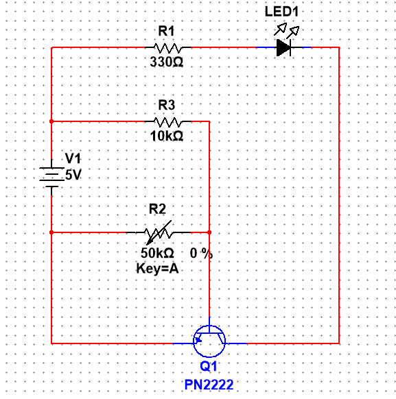

# Analog Automatic Lighting Control System

## 📖 Project Overview
This project is a fully functional **"Smart Twilight Switch"** designed using discrete analog components. Unlike modern solutions that rely on microcontrollers i.e arduino, this circuit utilizes fundamental semiconductor logic to automate a load based on ambient environmental conditions.

The system continuously monitors light levels via a photo-resistive sensor and automatically activates an LED load when darkness is detected.

## 🛠️ Tech Stack & Components
* **Simulation Software:** NI Multisim
* **Switching Logic:** NPN BJT Transistor (PN2222)
* **Sensor:** Light Dependent Resistor (LDR/Photoresistor)
* **Power Source:** 5V DC Supply
* **Passive Components:** 10kΩ & 330Ω Resistors, 100kΩ Potentiometer

## ⚡ How It Works
The circuit uses a **Voltage Divider Bias Network** to control the switching state of the transistor.

1.  **The Sensor (Input):** An LDR is placed in a voltage divider configuration with a 12kΩ pull-up resistor.
    * **Daytime:** The LDR resistance is low, creating a low-impedance path to Ground. The base voltage remains below the 0.7V threshold, keeping the transistor **OFF**.
    * **Nighttime:** The LDR resistance increases significantly, blocking the path to Ground. Voltage builds up at the base junction.
2.  **The Switch (Processing):** When the base voltage exceeds ~0.7V, the **PN2222 NPN Transistor** enters saturation mode.
3.  **The Load (Output):** The transistor closes the circuit, sinking current from the LED to Ground, illuminating the light.

## 📸 Media
The schematic:

[**▶️ Watch the Working Prototype Video**](https://youtube.com/shorts/_RVxD4d8n0g?si=jsib7reHaQ1FTKd_)

## 🔋 Power Analysis
* **Quiescent Current:** ~0.4mA (Daytime standby drain).
* **Active Load Current:** ~15mA (Nighttime operation).

## 🚀 Skills Demonstrated
* **Analog Circuit Design:** Designing logic without code.
* **Component Sizing:** Calculating resistor values for transistor biasing and LED protection.
* **Simulation:** Using NI Multisim to validate theory before physical prototyping.
* **Hardware Debugging:** Troubleshooting physical breadboard connections.
